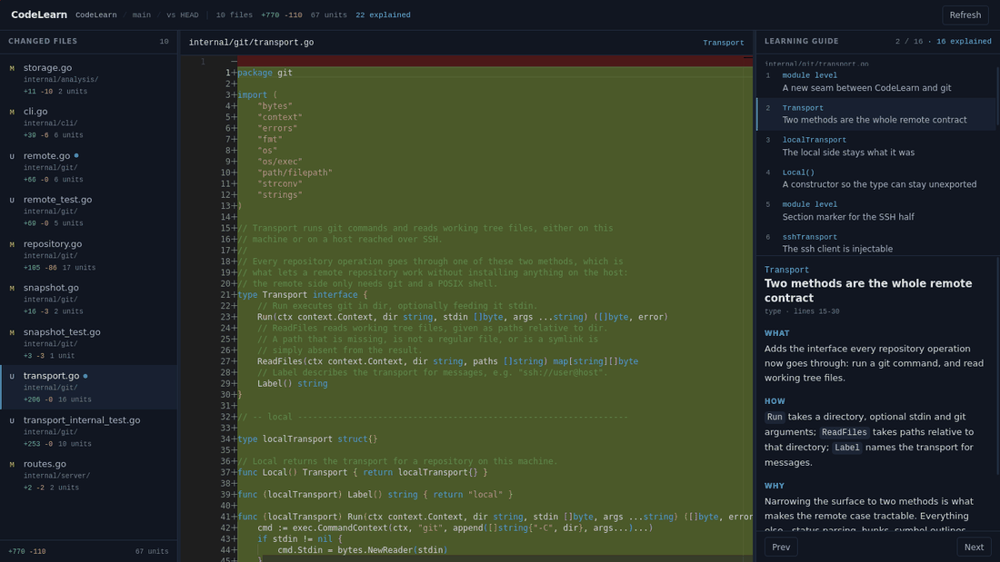

<p align="center">
  
</p>

<h1 align="center">CodeLearn</h1>

<p align="center">
  <strong>Read the code an agent just wrote, before you commit it.</strong>
</p>

<p align="center">
  A local-first viewer that pairs your uncommitted diff with
  <br>
  What / How / Why explanations, anchored to the functions they describe.
</p>

<p align="center">
  <a href="#install">Install</a> ·
  <a href="#quick-start">Quick start</a> ·
  <a href="docs/architecture.md">How it works</a> ·
  <a href="CONTRIBUTING.md">Contributing</a>
</p>

<p align="center">
  
</p>

---

A diff viewer tells you *which lines* changed. CodeLearn is for understanding
*what the new implementation does* — which is the problem when the code was
written by a coding agent and you are the one who has to review it.

```bash
cd my-project
codelearn .
```

Your browser opens on the uncommitted changes. Ask your coding agent to
analyse them with the [CodeLearn skill](skills/codelearn/SKILL.md), and each
function gains an explanation you can step through beside the code.

CodeLearn calls no language model and needs no API key.

## Features

**Pre-commit, not post-PR.** The subject is your working tree. No commit, no
branch, no pull request, no network.

**Units you recognise.** A change unit is a function, a method or a class —
not an arbitrary diff hunk that spans three of them. Go, Python, TypeScript,
JavaScript, C, C++, Java, C#, Rust, Swift and Kotlin are outlined; anything
else falls back to hunks and still works.

**Explanations that cannot drift.** Every unit has an id derived from its own
code. An explanation is shown only while that id survives, so a stale note is
withheld rather than pointed at the wrong lines.

**Agent-independent.** Claude Code, Codex, or anything that can run a shell
command and write a file. One shared skill, one JSON contract.

**Nothing left behind.** Your repository is read-only to CodeLearn.
Explanations live in your user cache directory, never in the working tree.

**A single binary.** The web viewer is embedded. Git is the only requirement.

## Install

Download a release binary, or build from source:

```bash
git clone https://github.com/inpyu/codelearn.git
cd codelearn
make build          # builds the frontend and embeds it in ./codelearn
```

Building needs Go 1.24+ and Node.js. Running the result needs neither — only
`git`.

## Quick start

```bash
codelearn                  # the repository you are standing in
codelearn /path/to/repo    # another repository
codelearn . --no-browser   # print the URL instead of opening a browser
```

| Pane | Shows |
| --- | --- |
| Changed Files | modified, staged, unstaged, added, deleted, renamed and untracked files, with totals |
| Diff Viewer | side-by-side Before/After; clicking code selects the unit it belongs to |
| Learning Guide | every change unit of the selected file, with Prev/Next and What / How / Why |

Press **Refresh** to re-read git — CodeLearn does not watch the filesystem.
Drag the dividers to rebalance the panes.

### Getting explanations

Install the shared skill for your agent (see [skills/](skills/README.md)) and
ask in your own words:

> Analyse the current changes with CodeLearn so I can learn them.

The agent runs `codelearn export`, reads the code around each unit, writes one
step per unit, and runs `codelearn import`. Press Refresh.

Without a skill, everything except the Learning Guide still works — CodeLearn
is a perfectly good pre-commit diff viewer on its own.

## Repositories on another machine

Edit code on a server, read it on your laptop. CodeLearn runs where you
install it and drives git over SSH, so **nothing is installed on the server** —
it needs only `git` and a POSIX shell.

```bash
codelearn --remote me@build-server:/srv/project
codelearn export --remote me@build-server:/srv/project -o changes.json
codelearn import analysis.json --remote me@build-server:/srv/project
```

Connections are multiplexed over one SSH master, so a snapshot costs a single
handshake rather than one per command. Every argument sent to the remote shell
is quoted, and analyses are cached per host, so the same project on your
laptop and on a server keeps separate explanations.

## Documentation

| | |
| --- | --- |
| [docs/architecture.md](docs/architecture.md) | change units, identifiers, data formats, the HTTP API, performance |
| [skills/README.md](skills/README.md) | installing the shared skill for your agent |
| [CONTRIBUTING.md](CONTRIBUTING.md) | development setup, layout, tests, releases |
| [SECURITY.md](SECURITY.md) | the security model, and how to report a problem |
| [SPEC.md](SPEC.md) | the specification this implements |
| [CHANGELOG.md](CHANGELOG.md) | what changed, and when |

## Scope

This is an MVP. It deliberately leaves out PR integrations, a VS Code
extension, an MCP server, any built-in LLM, call graphs, quality scoring and
quizzes. See [SPEC.md](SPEC.md) for the boundary, and for the two places the
implementation has deliberately outgrown it.

## License

MIT — see [LICENSE](LICENSE).
